# EcoShare — Phase 2 Database Schema & Data Models

**Project:** EcoShare  
**Document Version:** 2.1  
**Status:** Approved Schema Draft (Reconciled)  
**Target Database:** Supabase PostgreSQL 15+  
**Date:** November 2026  

---

## 1. Table Architecture Reconciliation

The EcoShare database architecture comprises **22 distinct tables**:
- **19 Core Feature Domain Tables:** `profiles`, `user_roles`, `posts`, `post_media`, `post_likes`, `post_comments`, `post_bookmarks`, `follows`, `communities`, `community_members`, `challenges`, `challenge_participants`, `impact_submissions`, `xp_ledger`, `user_badges`, `conversations`, `conversation_participants`, `messages`, `notifications`.
- **3 Operational, Audit & Idempotency Tables:** `verification_audit_log`, `reports`, `processed_webhook_events`.

---

## 2. Entity-Relationship Diagram

```mermaid
erDiagram
    profiles ||--o{ user_roles : "assigned"
    profiles ||--o{ posts : "authors"
    profiles ||--o{ post_likes : "likes"
    profiles ||--o{ post_comments : "comments"
    profiles ||--o{ post_bookmarks : "bookmarks"
    profiles ||--o{ follows : "follower/following"
    profiles ||--o{ community_members : "joins"
    profiles ||--o{ challenge_participants : "participates"
    profiles ||--o{ impact_submissions : "submits"
    profiles ||--o{ impact_submissions : "verifies"
    profiles ||--o{ xp_ledger : "accrues"
    profiles ||--o{ user_badges : "earns"
    profiles ||--o{ conversation_participants : "participates"
    profiles ||--o{ messages : "sends"
    profiles ||--o{ notifications : "receives"
    profiles ||--o{ verification_audit_log : "verifies/audits"
    profiles ||--o{ reports : "reports"

    posts ||--o{ post_media : "contains"
    posts ||--o{ post_likes : "has"
    posts ||--o{ post_comments : "has"
    posts ||--o{ post_bookmarks : "has"
    posts ||--o{ reports : "reported"

    communities ||--o{ community_members : "has"
    communities ||--o{ posts : "scopes"
    communities ||--o{ challenges : "hosts"

    challenges ||--o{ challenge_participants : "enrolls"
    challenges ||--o{ impact_submissions : "fulfills"

    impact_submissions ||--o{ xp_ledger : "awards"
    impact_submissions ||--o{ verification_audit_log : "logs"

    conversations ||--o{ conversation_participants : "includes"
    conversations ||--o{ messages : "contains"

    profiles {
        text user_id PK "Clerk User ID"
        text username UK
        text display_name
        text avatar_url
        text bio
        text location
        text website
        integer total_xp
        integer level
        timestamptz created_at
        timestamptz updated_at
    }

    user_roles {
        uuid id PK
        text user_id FK
        text role "user, moderator, verifier, admin"
        text granted_by
        timestamptz granted_at
    }

    posts {
        uuid id PK
        text author_id FK
        text content
        text post_type "story, update, question, tip"
        uuid community_id FK
        integer likes_count
        integer comments_count
        integer bookmarks_count
        boolean is_pinned
        timestamptz created_at
        timestamptz updated_at
    }

    post_media {
        uuid id PK
        uuid post_id FK
        text media_type "image, video"
        text url
        text thumbnail_url
        integer width
        integer height
        integer order_index
        timestamptz created_at
    }

    post_likes {
        uuid id PK
        uuid post_id FK
        text user_id FK
        timestamptz created_at
    }

    post_comments {
        uuid id PK
        uuid post_id FK
        text user_id FK
        uuid parent_comment_id FK
        text content
        timestamptz created_at
        timestamptz updated_at
    }

    post_bookmarks {
        uuid id PK
        uuid post_id FK
        text user_id FK
        timestamptz created_at
    }

    follows {
        uuid id PK
        text follower_id FK
        text following_id FK
        timestamptz created_at
    }

    communities {
        uuid id PK
        text slug UK
        text name
        text description
        text avatar_url
        text banner_url
        text creator_id FK
        boolean is_private
        integer member_count
        timestamptz created_at
        timestamptz updated_at
    }

    community_members {
        uuid id PK
        uuid community_id FK
        text user_id FK
        text role "member, moderator, admin"
        timestamptz joined_at
    }

    challenges {
        uuid id PK
        text slug UK
        text title
        text description
        text category
        text difficulty "easy, medium, hard"
        integer xp_reward
        text icon_name
        uuid community_id FK
        integer participant_count
        integer completion_count
        timestamptz start_date
        timestamptz end_date
        boolean is_active
        timestamptz created_at
    }

    challenge_participants {
        uuid id PK
        uuid challenge_id FK
        text user_id FK
        text status "active, completed, abandoned"
        integer progress
        timestamptz joined_at
        timestamptz completed_at
    }

    impact_submissions {
        uuid id PK
        text submitter_id FK
        uuid challenge_id FK
        text title
        text description
        text category
        jsonb evidence_urls "Signed storage paths"
        jsonb location_data "Lat, Long, Place"
        text status "pending, under_review, approved, rejected"
        text verifier_id FK
        text rejection_reason
        text verifier_notes
        integer xp_awarded
        timestamptz submitted_at
        timestamptz verified_at
    }

    xp_ledger {
        uuid id PK
        text user_id FK
        integer amount
        text source_type "impact_submission, challenge_completion, milestone"
        uuid source_id
        text description
        timestamptz created_at
    }

    user_badges {
        uuid id PK
        text user_id FK
        text badge_id
        text badge_name
        text category
        text tier "bronze, silver, gold, platinum"
        timestamptz unlocked_at
    }

    conversations {
        uuid id PK
        boolean is_group
        text title
        timestamptz created_at
        timestamptz updated_at
    }

    conversation_participants {
        uuid id PK
        uuid conversation_id FK
        text user_id FK
        timestamptz last_read_at
        timestamptz joined_at
    }

    messages {
        uuid id PK
        uuid conversation_id FK
        text sender_id FK
        text content
        jsonb media_attachments
        boolean is_read
        timestamptz created_at
    }

    notifications {
        uuid id PK
        text recipient_id FK
        text actor_id FK
        text event_type "like, comment, follow, verification_approved, verification_rejected, badge_earned, challenge_update"
        text title
        text message
        jsonb action_url
        boolean is_read
        timestamptz created_at
    }

    verification_audit_log {
        uuid id PK
        uuid submission_id FK
        text verifier_id FK
        text action "submitted, reviewed, approved, rejected, amended"
        integer xp_awarded
        jsonb metadata
        timestamptz created_at
    }

    reports {
        uuid id PK
        text reporter_id FK
        text target_type "post, comment, user, submission"
        uuid target_id
        text reason
        text status "pending, resolved, dismissed"
        text reviewed_by FK
        timestamptz created_at
        timestamptz resolved_at
    }
```



---

## 2. Table Definitions & Database Schemas

### 2.1 Custom Enums
```sql
CREATE TYPE public.app_role AS ENUM ('user', 'moderator', 'verifier', 'admin');
CREATE TYPE public.post_type_enum AS ENUM ('story', 'update', 'question', 'tip');
CREATE TYPE public.media_type_enum AS ENUM ('image', 'video');
CREATE TYPE public.community_role_enum AS ENUM ('member', 'moderator', 'admin');
CREATE TYPE public.challenge_difficulty_enum AS ENUM ('easy', 'medium', 'hard');
CREATE TYPE public.challenge_status_enum AS ENUM ('active', 'completed', 'abandoned');
CREATE TYPE public.submission_status_enum AS ENUM ('pending', 'under_review', 'approved', 'rejected');
CREATE TYPE public.badge_tier_enum AS ENUM ('bronze', 'silver', 'gold', 'platinum');
CREATE TYPE public.report_status_enum AS ENUM ('pending', 'resolved', 'dismissed');
```

### 2.2 User Profiles (`public.profiles`)
Stores synced Clerk user metadata and public social profile data.
```sql
CREATE TABLE public.profiles (
    user_id TEXT PRIMARY KEY, -- Clerk User ID (user_2...)
    username TEXT UNIQUE NOT NULL,
    display_name TEXT NOT NULL,
    avatar_url TEXT,
    bio TEXT CHECK (char_length(bio) <= 500),
    location TEXT CHECK (char_length(location) <= 100),
    website TEXT CHECK (char_length(website) <= 255),
    total_xp INTEGER NOT NULL DEFAULT 0 CHECK (total_xp >= 0),
    level INTEGER NOT NULL DEFAULT 1 CHECK (level >= 1),
    created_at TIMESTAMPTZ NOT NULL DEFAULT timezone('utc'::text, now()),
    updated_at TIMESTAMPTZ NOT NULL DEFAULT timezone('utc'::text, now())
);

CREATE INDEX idx_profiles_username ON public.profiles(username);
CREATE INDEX idx_profiles_total_xp ON public.profiles(total_xp DESC);
```

### 2.3 User Roles (`public.user_roles`)
Assigns granular administrative and moderation roles. Never readable or writable by arbitrary clients.
```sql
CREATE TABLE public.user_roles (
    id UUID PRIMARY KEY DEFAULT gen_random_uuid(),
    user_id TEXT NOT NULL REFERENCES public.profiles(user_id) ON DELETE CASCADE,
    role public.app_role NOT NULL DEFAULT 'user',
    granted_by TEXT REFERENCES public.profiles(user_id) ON DELETE SET NULL,
    granted_at TIMESTAMPTZ NOT NULL DEFAULT timezone('utc'::text, now()),
    CONSTRAINT uq_user_roles_user_role UNIQUE (user_id, role)
);

CREATE INDEX idx_user_roles_user_id ON public.user_roles(user_id);
```

### 2.4 Posts (`public.posts`)
Social posts created by users. Ordinary posts carry zero verification weight and zero XP.
```sql
CREATE TABLE public.posts (
    id UUID PRIMARY KEY DEFAULT gen_random_uuid(),
    author_id TEXT NOT NULL REFERENCES public.profiles(user_id) ON DELETE CASCADE,
    content TEXT NOT NULL CHECK (char_length(content) >= 1 AND char_length(content) <= 3000),
    post_type public.post_type_enum NOT NULL DEFAULT 'story',
    community_id UUID REFERENCES public.communities(id) ON DELETE SET NULL,
    likes_count INTEGER NOT NULL DEFAULT 0 CHECK (likes_count >= 0),
    comments_count INTEGER NOT NULL DEFAULT 0 CHECK (comments_count >= 0),
    bookmarks_count INTEGER NOT NULL DEFAULT 0 CHECK (bookmarks_count >= 0),
    is_pinned BOOLEAN NOT NULL DEFAULT false,
    created_at TIMESTAMPTZ NOT NULL DEFAULT timezone('utc'::text, now()),
    updated_at TIMESTAMPTZ NOT NULL DEFAULT timezone('utc'::text, now())
);

CREATE INDEX idx_posts_author ON public.posts(author_id);
CREATE INDEX idx_posts_community ON public.posts(community_id);
CREATE INDEX idx_posts_created_at ON public.posts(created_at DESC);
```

### 2.5 Post Media (`public.post_media`)
Attached public photos and videos for social posts.
```sql
CREATE TABLE public.post_media (
    id UUID PRIMARY KEY DEFAULT gen_random_uuid(),
    post_id UUID NOT NULL REFERENCES public.posts(id) ON DELETE CASCADE,
    media_type public.media_type_enum NOT NULL,
    url TEXT NOT NULL,
    thumbnail_url TEXT,
    width INTEGER,
    height INTEGER,
    order_index INTEGER NOT NULL DEFAULT 0,
    created_at TIMESTAMPTZ NOT NULL DEFAULT timezone('utc'::text, now())
);

CREATE INDEX idx_post_media_post_id ON public.post_media(post_id);
```

### 2.6 Social Interactions: Likes, Comments, Bookmarks
```sql
CREATE TABLE public.post_likes (
    id UUID PRIMARY KEY DEFAULT gen_random_uuid(),
    post_id UUID NOT NULL REFERENCES public.posts(id) ON DELETE CASCADE,
    user_id TEXT NOT NULL REFERENCES public.profiles(user_id) ON DELETE CASCADE,
    created_at TIMESTAMPTZ NOT NULL DEFAULT timezone('utc'::text, now()),
    CONSTRAINT uq_post_likes UNIQUE (post_id, user_id)
);

CREATE INDEX idx_post_likes_post ON public.post_likes(post_id);
CREATE INDEX idx_post_likes_user ON public.post_likes(user_id);

CREATE TABLE public.post_comments (
    id UUID PRIMARY KEY DEFAULT gen_random_uuid(),
    post_id UUID NOT NULL REFERENCES public.posts(id) ON DELETE CASCADE,
    user_id TEXT NOT NULL REFERENCES public.profiles(user_id) ON DELETE CASCADE,
    parent_comment_id UUID REFERENCES public.post_comments(id) ON DELETE CASCADE,
    content TEXT NOT NULL CHECK (char_length(content) >= 1 AND char_length(content) <= 1000),
    created_at TIMESTAMPTZ NOT NULL DEFAULT timezone('utc'::text, now()),
    updated_at TIMESTAMPTZ NOT NULL DEFAULT timezone('utc'::text, now())
);

CREATE INDEX idx_post_comments_post ON public.post_comments(post_id);
CREATE INDEX idx_post_comments_parent ON public.post_comments(parent_comment_id);

CREATE TABLE public.post_bookmarks (
    id UUID PRIMARY KEY DEFAULT gen_random_uuid(),
    post_id UUID NOT NULL REFERENCES public.posts(id) ON DELETE CASCADE,
    user_id TEXT NOT NULL REFERENCES public.profiles(user_id) ON DELETE CASCADE,
    created_at TIMESTAMPTZ NOT NULL DEFAULT timezone('utc'::text, now()),
    CONSTRAINT uq_post_bookmarks UNIQUE (post_id, user_id)
);

CREATE INDEX idx_post_bookmarks_user ON public.post_bookmarks(user_id);
```

### 2.7 Follow Relationships (`public.follows`)
```sql
CREATE TABLE public.follows (
    id UUID PRIMARY KEY DEFAULT gen_random_uuid(),
    follower_id TEXT NOT NULL REFERENCES public.profiles(user_id) ON DELETE CASCADE,
    following_id TEXT NOT NULL REFERENCES public.profiles(user_id) ON DELETE CASCADE,
    created_at TIMESTAMPTZ NOT NULL DEFAULT timezone('utc'::text, now()),
    CONSTRAINT uq_follows UNIQUE (follower_id, following_id),
    CONSTRAINT chk_no_self_follow CHECK (follower_id != following_id)
);

CREATE INDEX idx_follows_follower ON public.follows(follower_id);
CREATE INDEX idx_follows_following ON public.follows(following_id);
```

### 2.8 Communities & Members (`public.communities`, `public.community_members`)
```sql
CREATE TABLE public.communities (
    id UUID PRIMARY KEY DEFAULT gen_random_uuid(),
    slug TEXT UNIQUE NOT NULL CHECK (slug ~* '^[a-z0-9_-]+$'),
    name TEXT NOT NULL CHECK (char_length(name) >= 3 AND char_length(name) <= 80),
    description TEXT NOT NULL CHECK (char_length(description) <= 1000),
    avatar_url TEXT,
    banner_url TEXT,
    creator_id TEXT NOT NULL REFERENCES public.profiles(user_id) ON DELETE RESTRICT,
    is_private BOOLEAN NOT NULL DEFAULT false,
    member_count INTEGER NOT NULL DEFAULT 1 CHECK (member_count >= 1),
    created_at TIMESTAMPTZ NOT NULL DEFAULT timezone('utc'::text, now()),
    updated_at TIMESTAMPTZ NOT NULL DEFAULT timezone('utc'::text, now())
);

CREATE INDEX idx_communities_slug ON public.communities(slug);

CREATE TABLE public.community_members (
    id UUID PRIMARY KEY DEFAULT gen_random_uuid(),
    community_id UUID NOT NULL REFERENCES public.communities(id) ON DELETE CASCADE,
    user_id TEXT NOT NULL REFERENCES public.profiles(user_id) ON DELETE CASCADE,
    role public.community_role_enum NOT NULL DEFAULT 'member',
    joined_at TIMESTAMPTZ NOT NULL DEFAULT timezone('utc'::text, now()),
    CONSTRAINT uq_community_members UNIQUE (community_id, user_id)
);

CREATE INDEX idx_community_members_comm ON public.community_members(community_id);
CREATE INDEX idx_community_members_user ON public.community_members(user_id);
```

### 2.9 Challenges & Participants (`public.challenges`, `public.challenge_participants`)
```sql
CREATE TABLE public.challenges (
    id UUID PRIMARY KEY DEFAULT gen_random_uuid(),
    slug TEXT UNIQUE NOT NULL,
    title TEXT NOT NULL CHECK (char_length(title) >= 5 AND char_length(title) <= 120),
    description TEXT NOT NULL,
    category TEXT NOT NULL,
    difficulty public.challenge_difficulty_enum NOT NULL DEFAULT 'medium',
    xp_reward INTEGER NOT NULL CHECK (xp_reward >= 10 AND xp_reward <= 1000),
    icon_name TEXT NOT NULL DEFAULT 'TreePine',
    community_id UUID REFERENCES public.communities(id) ON DELETE SET NULL,
    participant_count INTEGER NOT NULL DEFAULT 0 CHECK (participant_count >= 0),
    completion_count INTEGER NOT NULL DEFAULT 0 CHECK (completion_count >= 0),
    start_date TIMESTAMPTZ NOT NULL,
    end_date TIMESTAMPTZ NOT NULL,
    is_active BOOLEAN NOT NULL DEFAULT true,
    created_at TIMESTAMPTZ NOT NULL DEFAULT timezone('utc'::text, now()),
    CONSTRAINT chk_challenge_dates CHECK (end_date > start_date)
);

CREATE INDEX idx_challenges_active ON public.challenges(is_active, end_date);

CREATE TABLE public.challenge_participants (
    id UUID PRIMARY KEY DEFAULT gen_random_uuid(),
    challenge_id UUID NOT NULL REFERENCES public.challenges(id) ON DELETE CASCADE,
    user_id TEXT NOT NULL REFERENCES public.profiles(user_id) ON DELETE CASCADE,
    status public.challenge_status_enum NOT NULL DEFAULT 'active',
    progress INTEGER NOT NULL DEFAULT 0 CHECK (progress >= 0 AND progress <= 100),
    joined_at TIMESTAMPTZ NOT NULL DEFAULT timezone('utc'::text, now()),
    completed_at TIMESTAMPTZ,
    CONSTRAINT uq_challenge_participants UNIQUE (challenge_id, user_id)
);

CREATE INDEX idx_challenge_participants_user ON public.challenge_participants(user_id);
```

### 2.10 Environmental Impact Submissions (`public.impact_submissions`)
The core verified contribution entity. Evidence is strictly private.
```sql
CREATE TABLE public.impact_submissions (
    id UUID PRIMARY KEY DEFAULT gen_random_uuid(),
    submitter_id TEXT NOT NULL REFERENCES public.profiles(user_id) ON DELETE CASCADE,
    challenge_id UUID REFERENCES public.challenges(id) ON DELETE SET NULL,
    title TEXT NOT NULL CHECK (char_length(title) >= 5 AND char_length(title) <= 120),
    description TEXT NOT NULL CHECK (char_length(description) >= 20 AND char_length(description) <= 2500),
    category TEXT NOT NULL,
    evidence_urls JSONB NOT NULL DEFAULT '[]'::jsonb, -- Storage paths in private-impact-evidence
    location_data JSONB, -- { latitude, longitude, address_label }
    status public.submission_status_enum NOT NULL DEFAULT 'pending',
    verifier_id TEXT REFERENCES public.profiles(user_id) ON DELETE SET NULL,
    rejection_reason TEXT,
    verifier_notes TEXT,
    xp_awarded INTEGER NOT NULL DEFAULT 0 CHECK (xp_awarded >= 0),
    submitted_at TIMESTAMPTZ NOT NULL DEFAULT timezone('utc'::text, now()),
    verified_at TIMESTAMPTZ,
    CONSTRAINT chk_submission_verifier CHECK (verifier_id IS NULL OR verifier_id != submitter_id)
);

CREATE INDEX idx_impact_submissions_submitter ON public.impact_submissions(submitter_id);
CREATE INDEX idx_impact_submissions_status ON public.impact_submissions(status);
CREATE INDEX idx_impact_submissions_challenge ON public.impact_submissions(challenge_id);
```

### 2.11 Gamification & Reputation: XP Ledger & Badges
XP is append-only. No manual update to `profiles.total_xp` is ever permitted outside ledger rollups.
```sql
CREATE TABLE public.xp_ledger (
    id UUID PRIMARY KEY DEFAULT gen_random_uuid(),
    user_id TEXT NOT NULL REFERENCES public.profiles(user_id) ON DELETE CASCADE,
    amount INTEGER NOT NULL CHECK (amount > 0),
    source_type TEXT NOT NULL, -- 'impact_submission', 'challenge_completion', 'badge_unlock'
    source_id UUID,
    description TEXT NOT NULL,
    created_at TIMESTAMPTZ NOT NULL DEFAULT timezone('utc'::text, now())
);

CREATE INDEX idx_xp_ledger_user ON public.xp_ledger(user_id);

CREATE TABLE public.user_badges (
    id UUID PRIMARY KEY DEFAULT gen_random_uuid(),
    user_id TEXT NOT NULL REFERENCES public.profiles(user_id) ON DELETE CASCADE,
    badge_id TEXT NOT NULL, -- e.g. 'tree_planter_bronze'
    badge_name TEXT NOT NULL,
    category TEXT NOT NULL,
    tier public.badge_tier_enum NOT NULL DEFAULT 'bronze',
    unlocked_at TIMESTAMPTZ NOT NULL DEFAULT timezone('utc'::text, now()),
    CONSTRAINT uq_user_badges UNIQUE (user_id, badge_id)
);

CREATE INDEX idx_user_badges_user ON public.user_badges(user_id);
```

### 2.12 Direct Messaging (`public.conversations`, `public.conversation_participants`, `public.messages`)
```sql
CREATE TABLE public.conversations (
    id UUID PRIMARY KEY DEFAULT gen_random_uuid(),
    is_group BOOLEAN NOT NULL DEFAULT false,
    title TEXT,
    created_at TIMESTAMPTZ NOT NULL DEFAULT timezone('utc'::text, now()),
    updated_at TIMESTAMPTZ NOT NULL DEFAULT timezone('utc'::text, now())
);

CREATE TABLE public.conversation_participants (
    id UUID PRIMARY KEY DEFAULT gen_random_uuid(),
    conversation_id UUID NOT NULL REFERENCES public.conversations(id) ON DELETE CASCADE,
    user_id TEXT NOT NULL REFERENCES public.profiles(user_id) ON DELETE CASCADE,
    last_read_at TIMESTAMPTZ NOT NULL DEFAULT timezone('utc'::text, now()),
    joined_at TIMESTAMPTZ NOT NULL DEFAULT timezone('utc'::text, now()),
    CONSTRAINT uq_conversation_participants UNIQUE (conversation_id, user_id)
);

CREATE INDEX idx_conv_part_user ON public.conversation_participants(user_id);

CREATE TABLE public.messages (
    id UUID PRIMARY KEY DEFAULT gen_random_uuid(),
    conversation_id UUID NOT NULL REFERENCES public.conversations(id) ON DELETE CASCADE,
    sender_id TEXT NOT NULL REFERENCES public.profiles(user_id) ON DELETE CASCADE,
    content TEXT NOT NULL CHECK (char_length(content) >= 1 AND char_length(content) <= 2000),
    media_attachments JSONB DEFAULT '[]'::jsonb,
    is_read BOOLEAN NOT NULL DEFAULT false,
    created_at TIMESTAMPTZ NOT NULL DEFAULT timezone('utc'::text, now())
);

CREATE INDEX idx_messages_conv ON public.messages(conversation_id, created_at ASC);
```

### 2.13 Notifications, Audit Log & Reports
```sql
CREATE TABLE public.notifications (
    id UUID PRIMARY KEY DEFAULT gen_random_uuid(),
    recipient_id TEXT NOT NULL REFERENCES public.profiles(user_id) ON DELETE CASCADE,
    actor_id TEXT REFERENCES public.profiles(user_id) ON DELETE SET NULL,
    event_type TEXT NOT NULL,
    title TEXT NOT NULL,
    message TEXT NOT NULL,
    action_url TEXT,
    is_read BOOLEAN NOT NULL DEFAULT false,
    created_at TIMESTAMPTZ NOT NULL DEFAULT timezone('utc'::text, now())
);

CREATE INDEX idx_notifications_recipient ON public.notifications(recipient_id, is_read, created_at DESC);

CREATE TABLE public.verification_audit_log (
    id UUID PRIMARY KEY DEFAULT gen_random_uuid(),
    submission_id UUID NOT NULL REFERENCES public.impact_submissions(id) ON DELETE CASCADE,
    verifier_id TEXT NOT NULL REFERENCES public.profiles(user_id) ON DELETE RESTRICT,
    action TEXT NOT NULL, -- 'approved', 'rejected', 'escalated'
    xp_awarded INTEGER NOT NULL DEFAULT 0,
    metadata JSONB NOT NULL DEFAULT '{}'::jsonb,
    created_at TIMESTAMPTZ NOT NULL DEFAULT timezone('utc'::text, now())
);

CREATE INDEX idx_audit_log_submission ON public.verification_audit_log(submission_id);

CREATE TABLE public.reports (
    id UUID PRIMARY KEY DEFAULT gen_random_uuid(),
    reporter_id TEXT NOT NULL REFERENCES public.profiles(user_id) ON DELETE CASCADE,
    target_type TEXT NOT NULL, -- 'post', 'comment', 'user', 'submission'
    target_id UUID NOT NULL,
    reason TEXT NOT NULL CHECK (char_length(reason) <= 500),
    status public.report_status_enum NOT NULL DEFAULT 'pending',
    reviewed_by TEXT REFERENCES public.profiles(user_id) ON DELETE SET NULL,
    created_at TIMESTAMPTZ NOT NULL DEFAULT timezone('utc'::text, now()),
    resolved_at TIMESTAMPTZ
);

CREATE TABLE public.processed_webhook_events (
    event_id TEXT PRIMARY KEY,
    event_type TEXT NOT NULL,
    processed_at TIMESTAMPTZ NOT NULL DEFAULT timezone('utc'::text, now())
);
```

---

## 3. Database Functions & Atomic Verification RPCs

### 3.1 Impact Verification RPC (`approve_impact_submission`)
The central business logic for environmental verification. It is transactional, idempotent, and enforces role authorization at the database layer.

```sql
CREATE OR REPLACE FUNCTION public.approve_impact_submission(
    p_submission_id UUID,
    p_verifier_id TEXT,
    p_xp_amount INTEGER,
    p_verifier_notes TEXT DEFAULT NULL
)
RETURNS JSONB
LANGUAGE plpgsql
SECURITY DEFINER
SET search_path = public, pg_temp
AS $$
DECLARE
    v_submission RECORD;
    v_new_total_xp INTEGER;
    v_new_level INTEGER;
    v_result JSONB;
BEGIN
    -- 1. Verify caller has verifier or admin role
    IF NOT EXISTS (
        SELECT 1 FROM public.user_roles 
        WHERE user_id = p_verifier_id 
          AND role IN ('verifier', 'admin')
    ) THEN
        RAISE EXCEPTION 'Unauthorized: Caller is not a designated verifier or administrator.'
            USING ERRCODE = '42501';
    END IF;

    -- 2. Lock and retrieve submission
    SELECT * INTO v_submission
    FROM public.impact_submissions
    WHERE id = p_submission_id
    FOR UPDATE;

    IF NOT FOUND THEN
        RAISE EXCEPTION 'Impact submission % not found', p_submission_id
            USING ERRCODE = 'P0002';
    END IF;

    -- 3. Prevent self-verification
    IF v_submission.submitter_id = p_verifier_id THEN
        RAISE EXCEPTION 'Conflict: Submitter cannot verify their own environmental submission.'
            USING ERRCODE = '23514';
    END IF;

    -- 4. Enforce idempotency (must be pending or under_review)
    IF v_submission.status = 'approved' THEN
        RETURN jsonb_build_object(
            'success', true,
            'message', 'Submission is already approved',
            'submission_id', p_submission_id
        );
    END IF;

    -- 5. Validate XP amount
    IF p_xp_amount <= 0 OR p_xp_amount > 1000 THEN
        RAISE EXCEPTION 'Invalid XP amount: % (must be between 1 and 1000)', p_xp_amount
            USING ERRCODE = '22003';
    END IF;

    -- 6. Update Submission Status
    UPDATE public.impact_submissions
    SET status = 'approved',
        verifier_id = p_verifier_id,
        verifier_notes = p_verifier_notes,
        xp_awarded = p_xp_amount,
        verified_at = timezone('utc'::text, now())
    WHERE id = p_submission_id;

    -- 7. Insert into Immutable XP Ledger
    INSERT INTO public.xp_ledger (
        user_id,
        amount,
        source_type,
        source_id,
        description
    ) VALUES (
        v_submission.submitter_id,
        p_xp_amount,
        'impact_submission',
        p_submission_id,
        'Verified Environmental Impact: ' || v_submission.title
    );

    -- 8. Recalculate User Total XP and Level using approved EcoShare thresholds
    SELECT COALESCE(SUM(amount), 0) INTO v_new_total_xp
    FROM public.xp_ledger
    WHERE user_id = v_submission.submitter_id;

    -- EcoShare Official 6-Tier Level Thresholds:
    -- Level 1 (Eco Starter): 0 XP
    -- Level 2 (Good Collector): 50 XP
    -- Level 3 (Eco Guardian): 150 XP
    -- Level 4 (Planet Protector): 350 XP
    -- Level 5 (Earth Champion): 700 XP
    -- Level 6 (Planet Legend): 1500 XP
    v_new_level := CASE
        WHEN v_new_total_xp >= 1500 THEN 6
        WHEN v_new_total_xp >= 700  THEN 5
        WHEN v_new_total_xp >= 350  THEN 4
        WHEN v_new_total_xp >= 150  THEN 3
        WHEN v_new_total_xp >= 50   THEN 2
        ELSE 1
    END;

    UPDATE public.profiles
    SET total_xp = v_new_total_xp,
        level = v_new_level,
        updated_at = timezone('utc'::text, now())
    WHERE user_id = v_submission.submitter_id;

    -- 9. Check Challenge Completion if linked
    IF v_submission.challenge_id IS NOT NULL THEN
        UPDATE public.challenge_participants
        SET status = 'completed',
            progress = 100,
            completed_at = timezone('utc'::text, now())
        WHERE challenge_id = v_submission.challenge_id
          AND user_id = v_submission.submitter_id
          AND status = 'active';

        UPDATE public.challenges
        SET completion_count = completion_count + 1
        WHERE id = v_submission.challenge_id;
    END IF;

    -- 10. Audit Log Entry
    INSERT INTO public.verification_audit_log (
        submission_id,
        verifier_id,
        action,
        xp_awarded,
        metadata
    ) VALUES (
        p_submission_id,
        p_verifier_id,
        'approved',
        p_xp_amount,
        jsonb_build_object('notes', p_verifier_notes)
    );

    -- 11. Create Notification for Submitter
    INSERT INTO public.notifications (
        recipient_id,
        actor_id,
        event_type,
        title,
        message,
        action_url
    ) VALUES (
        v_submission.submitter_id,
        p_verifier_id,
        'verification_approved',
        'Impact Submission Approved! 🎉',
        'Your submission "' || v_submission.title || '" was verified. You earned ' || p_xp_amount || ' XP!',
        '/impact'
    );

    RETURN jsonb_build_object(
        'success', true,
        'submission_id', p_submission_id,
        'xp_awarded', p_xp_amount,
        'new_total_xp', v_new_total_xp,
        'new_level', v_new_level
    );
END;
$$;
```
